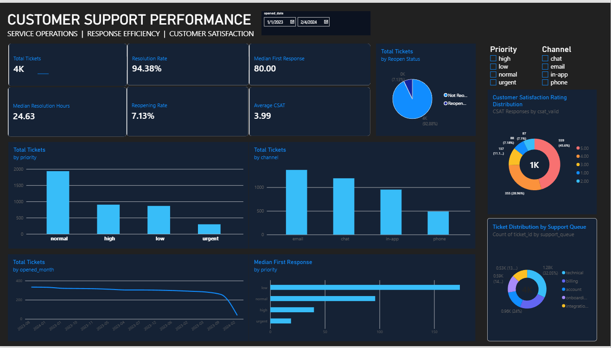

# Customer Support Ticket Analytics

An end-to-end data analytics project exploring customer support ticket performance, response and resolution times, customer satisfaction, ticket priorities, and support team workloads.

This project uses Python, SQL, and Power BI to transform raw support ticket data into meaningful business insights.

## Power BI Dashboard Preview



*Customer Support Performance dashboard developed in Power BI.*

## Project Overview

Customer support teams need to understand how efficiently tickets are handled, which support areas experience longer resolution times, and how customers rate their support experience.

This project analyzes 4,000 support ticket records to identify operational patterns, evaluate available performance indicators, and highlight areas that may require further investigation.

### Business Objectives

- Analyze ticket volume and distribution.
- Evaluate first response and resolution times.
- Compare performance across support teams and ticket priorities.
- Examine customer satisfaction ratings.
- Identify reopened tickets and data quality issues.
- Present key findings through a Power BI dashboard.

## Key Findings

| Metric | Result |
|---|---:|
| Total tickets | 4,000 |
| Tickets with recorded resolution time | 3,775 (94.38%) |
| Tickets with valid first response time | 3,708 (92.70%) |
| Median first response time | 80 minutes |
| Median resolution time | 24.63 hours |
| Average CSAT among valid ratings | 3.99 / 5 |
| Tickets with valid CSAT ratings | 1,226 (30.65%) |
| Reopened tickets | 285 (7.13%) |
| Chronology conflicts identified | 143 |

### Additional Insights

- The Technical support queue contains 1,282 tickets (32.05% of the dataset).
- The Integrations queue has the highest observed median resolution time, approximately 42.67 hours.
- The Technical queue has a median resolution time of approximately 39.19 hours.
- Urgent-priority tickets have a median first response time of 19 minutes, compared with 173.5 minutes for Low-priority tickets.

These findings describe the available dataset and should not be interpreted as proof of causation or SLA compliance.

## Dataset Information

**Source:** [Datanemics – Support Tickets Dataset](https://datanemics.com/datasets/support-tickets/)

**License:** CC0 – Public Domain

**Dataset size:** 4,000 ticket records

**Date range:** January 1, 2023 – February 4, 2024

The project retains the raw dataset separately from the processed dataset to support transparency and reproducibility.

## Tools and Technologies

- **Python:** Data cleaning, exploratory data analysis, and validation.
- **Pandas:** Data manipulation and analysis.
- **Jupyter Notebook:** Reproducible analytical workflow.
- **SQL:** Data querying and business analysis.
- **Power BI:** Dashboard development and visualization.
- **DAX:** Analytical measures and KPI calculations.
- **GitHub:** Project documentation and version control.

## Repository Structure

```text
02-customer-support-analytics/
│
├── ai_notes/
│   ├── README.md
│   ├── AI_ASSISTANCE_AND_DECISION_LOG.md
│   └── POWER_BI_BUILD_NOTES.md
│
├── data/
│   ├── raw/
│   │   └── support-tickets.csv
│   └── processed/
│       └── support_tickets_cleaned.csv
│
├── docs/
│   ├── business_questions.md
│   ├── data_dictionary.md
│   ├── data_quality_validation.md
│   ├── executive_insights.md
│   └── source_and_license.md
│
├── notebooks/
│   └── customer_support_ticket_analysis.ipynb
│
├── powerbi/
│   ├── README.md
│   ├── dashboard_preview.png
│   ├── customer_support_measures.dax
│   ├── customer_support_theme.json
│   └── dashboard_design_guide.md
│
├── sql/
│   ├── 01_initial_database_import.sql
│   ├── 02_complete_sql_analytics.sql
│   └── 03_key_business_queries.sql
│
├── .gitignore
└── README.md
```

## Analytical Workflow

1. **Data inspection:** Examine the raw dataset, understand its structure, and identify relevant business questions.
2. **Data cleaning:** Handle missing values, validate data types, and prepare the processed dataset.
3. **Exploratory analysis:** Analyze ticket volume, response times, resolution times, priorities, support queues, and customer satisfaction.
4. **Data validation:** Identify missing values and chronology conflicts without silently deleting potentially meaningful records.
5. **SQL analysis:** Use SQL queries to investigate operational metrics and answer business questions.
6. **Dashboard development:** Build Power BI measures and visualizations to communicate findings.

## Data Quality and Limitations

The analysis considers the following limitations:

- Resolution time is missing for 225 records.
- First response time is missing for 149 records.
- An additional 143 records contain chronology conflicts where the recorded first response occurred after the recorded resolution.
- CSAT ratings are available for only 1,226 records; 2,774 records have no valid rating.
- The dataset does not provide an authoritative SLA target, staffing information, or sufficient customer identifiers for customer-level analysis.
- The date range includes only partial coverage of February 2024.

The dashboard's resolution rate represents the proportion of records with a recorded resolution time. It does not independently verify ticket closure status.

Missing values and chronology conflicts are treated as data quality considerations. Metrics are calculated using valid recorded values where appropriate.

## Project Status

- [x] Dataset inspection
- [x] Data cleaning and preprocessing
- [x] Exploratory data analysis
- [x] SQL analysis
- [x] Documentation and data validation
- [x] Power BI dashboard preview
- [ ] Final Power BI report file (.pbix) export

## AI Assistance and Transparency

AI tools were used as part of the development workflow for selected tasks, including brainstorming, documentation support, code assistance, and debugging.

Analytical decisions, validation, and interpretation should be reviewed against the underlying data and documented project files.

Additional information is available in the `ai_notes/` directory.

## Author

**Data Analytics Portfolio Project**

This project demonstrates an end-to-end analytical workflow, from raw data preparation to business insights and dashboard development.
